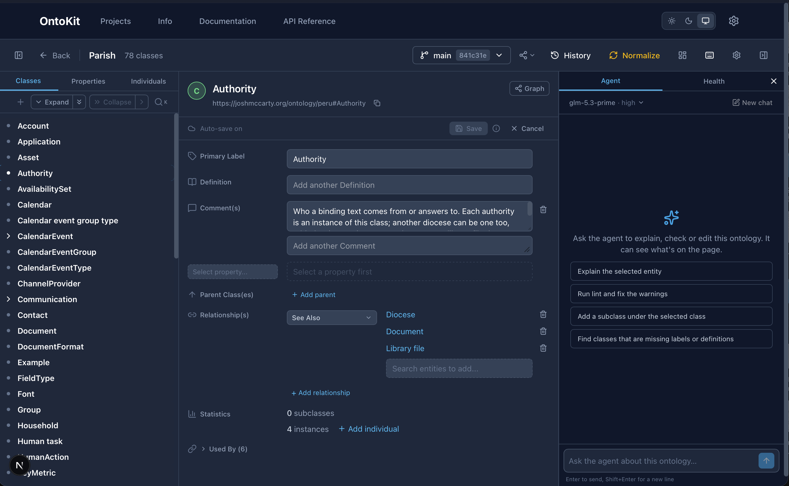

# OntoBuild

OntoBuild is a local, single-user workspace for building an OWL/RDF ontology together with
the code that uses it, with an LLM agent that can work on both. Each project is a folder in its
own git repository: one Turtle ontology file, edited through forms and saved as git commits,
and a `code/` folder for the project's application code, with files, terminals, a dev server
and code analysis tools alongside the editor.

It runs as one Node app: a Next.js frontend and an HTTP API (`/api/v1`) served by the same Next
server, with metadata in SQLite. There is no login. Everything runs on your machine except the
optional editor agent, which calls OpenRouter (see [Editor agent](#editor-agent)).



## Features

### Ontology

- **Projects.** Create an empty project, upload an ontology in Turtle (`.ttl`), N3,
  N-Triples (`.nt`), N-Quads (`.nq`), TriG, RDF/XML (`.owl`, `.rdf`, `.xml`) or JSON-LD
  (`.jsonld`, `.json`), or clone a Git repository (HTTPS or SSH URL) with its full history.
  Non-Turtle files are converted to Turtle before they are committed.
- **One active ontology file.** A project edits one ontology file at a time. If the folder holds
  several RDF files (common in a cloned repository), switch between them from the file name in
  the editor's breadcrumb, or choose and create files under **Settings → Ontology File**. A cloned `.ttl` file is edited in place.
- **Form-based editor.** Browse classes, properties and individuals, and add, edit and
  delete entities through forms. Every change is saved immediately as a git commit.
- **Branches and pull requests.** Work on branches, open pull requests, review, comment and
  merge.
- **Health checks.** Lint rules, consistency checks, duplicate detection and normalization,
  run as background jobs, with results shown in the editor's **Health** tab. The same counts
  appear in the **Agent** tab with a **Fix issues** button (see [Editor agent](#editor-agent)).
- **Changes made outside the editor.** If the ontology file in the project folder is changed by
  something else (a terminal, a text editor, another agent), the editor shows a notice and
  refuses to save over it until you commit or discard the change.
- **History and analytics.** Per-entity change history, project activity and the most
  frequently edited entities.
- **Imports.** **Settings → Imports** adds `owl:imports` to the ontology: pick another
  OntoBuild project or paste any ontology IRI. Imports are followed transitively (for example
  general principles → Node → your project), and imported classes appear read-only in the class
  tree, where your own classes can subclass them.

### Code

- **The `code/` folder.** Each project has a `code/` folder for the application, scripts or
  tooling built on the ontology. Code files are not committed automatically: commit them with
  git in a terminal (or ask the agent to), as you would in any repository.
- **Files and Quick View.** The **Files** tab in the right sidebar browses and searches the
  project folder. **Space** opens a Quick View of the selected file (code, text, Markdown,
  images, PDF, CSV, Word documents, audio and video) and closes it again.
- **Terminals.** Files ending in `.sh`, `.py`, `.ts` or `.js` run from the Files tab, in a
  tabbed terminal panel at the bottom of the editor that can also open interactive shells.
- **Dev server and View in Browser.** The run menu in the sub-heading starts and stops a dev
  server command for the project, and **View in Browser** opens the URL it reports.
- **Code tools.** The **Tools** tab in the right sidebar analyzes the JavaScript and TypeScript
  in `code/` statically, with the TypeScript compiler, so the dev server doesn't need to be
  running:
  - **Component tree:** which React components render which, resolved through imports, barrel
    files and `tsconfig`/`jsconfig` paths.
  - **Orphans:** files, exports, tests and scripts that nothing reaches from the project's
    entry points (Next.js `app/` and `pages/`, `package.json`, `index.html` and so on).
- **GitHub.** Under **Settings → GitHub**, link a project to a GitHub (or other git) remote,
  then fetch, pull and push, or create the repository with the `gh` CLI. Sign-in uses your
  existing git credentials, SSH keys or `gh auth login`; OntoBuild stores no tokens.

### Agent and API
- **Run as prompt, with approval.** The ▶ button next to any text value puts that text in the
  agent's message box (it is not sent until you send it). A green dot means the text was
  approved: it reached the default branch through a merged pull request with an approving
  review. Otherwise OntoBuild asks before using it. This lets a team agree on a prompt, as part of
  the ontology, before anyone runs it.
- **Editor agent.** An optional LLM chat in the editor that works on the open project: the
  ontology, its branches and pull requests, and, when you allow it, the code in the project
  folder (see [Editor agent](#editor-agent)).
- **Documented API.** Every operation is described in an OpenAPI 3.1 document served at
  `/api/v1/openapi.json` and rendered at `/api-docs`.

All text values (labels, comments, definitions, annotations) are plain strings without
language tags. Tags are removed when a file is imported or a change is committed.

## Origins

OntoBuild is derived from two projects by CatholicOS:
[ontokit-web](https://github.com/CatholicOS/ontokit-web), a Next.js frontend, and
[ontokit-api](https://github.com/CatholicOS/ontokit-api), a FastAPI backend. The frontend code
in this repository started from ontokit-web, and the API in `server/` started as a TypeScript
port of ontokit-api. Both have since been reworked into a standalone local app. Credit for
OntoKit goes to its authors, Fr. John R. D'Orazio ([@JohnRDOrazio](https://github.com/JohnRDOrazio))
and Damien Riehl ([@damienriehl](https://github.com/damienriehl)), and the other contributors
to ontokit-web and ontokit-api.

## Requirements

- Node.js 24 or newer (uses the built-in `node:sqlite`, no native build step). Use 24.15 or
  newer to avoid `EBADENGINE` warnings from the test dependencies (jsdom) during `npm install`.
  The app itself runs on any 24.x.
- `git` 2.38 or newer on your `PATH` (branch merges use `git merge-tree --write-tree`)
- Optional: an [OpenRouter](https://openrouter.ai) API key for the editor agent

No database server or Docker is needed.

## Installation and getting started

```bash
git clone <this repository> ontobuild
cd ontobuild
npm install
npm run dev          # development server on http://localhost:3000 (this machine only)
```

Open http://localhost:3000, choose **New project**, and either create an empty project or
import an ontology file. The `data/` directory is created on first start, so there is no
database setup step.

Production build:

```bash
npm run build
npm start            # http://localhost:3000 (set PORT to change it)
```

Terminals use `node-pty`, which ships prebuilt binaries for macOS and Windows. On Linux,
`npm install` compiles it, so you need Python 3 and a C++ toolchain (`build-essential`).

Other scripts: `npm run type-check`, `npm run lint`, `npm test` (vitest).

The `dev` and `start` scripts set `NODE_OPTIONS` inline to hide Node's SQLite
ExperimentalWarning. That syntax works on macOS and Linux. On Windows, run `npx next dev` or
`npx next start` directly.

## Data

All runtime data lives in `./data`, which is gitignored. Set `ONTOBUILD_DATA_DIR` to store it
somewhere else.

- `data/import-cache/`: cached copies of imported ontologies fetched from the web
- `data/ontobuild.db`: SQLite database (projects, branch metadata, pull requests, reviews,
  comments, lint runs, issues and per-project lint configs, quality results, normalization
  runs, entity change events, background jobs, user and agent settings)
- `data/projects/<folder>/`: one folder per project, named after the project when it is
  created. It is a normal git repository: `ontology.ttl` (Turtle, or the active ontology file
  of a cloned repository) and a `code/` folder for the project's code. Each branch is a git
  branch, and each save in the editor is a commit. Files under `code/` are committed only when
  you (or the agent, with Edit Code on) run git.
  Edits to the checked-out branch are written to the folder too. If `ontology.ttl` has
  uncommitted changes there, the editor refuses to save over them until you commit or
  discard them.

Projects created before project folders existed were stored as bare repositories in
`data/repos/<projectId>.git`. They are moved into `data/projects/` automatically the first
time the server handles a request.

To reset everything, stop the server and delete `data/`.

## Editor agent

The **Agent** tab in the editor's right sidebar is a chat with an LLM, run through
[OpenRouter](https://openrouter.ai), that works on the open project and branch through a fixed
set of tools. It cannot reach other projects except the ones this project imports.

### What it sees

Each message carries a short description of what you are looking at: the page, the selected
entity, the active ontology file and the current health counts. So "explain this class" or "add
a subclass here" refer to the entity selected in the editor. The tab also offers starter
prompts, such as explaining the selected entity or running the health checks and fixing what
they find.

### Ontology work (Edit Ontology)

- **Read and search:** the class tree, entities and their references, the Turtle source, the
  revision history and diffs.
- **Edit:** create, update and delete classes, properties and individuals, or edit the Turtle
  source directly for constructs the forms can't express (restrictions, prefixes, the ontology
  header). Each change is a normal commit on the current branch with its own message, and the
  editor refreshes as the agent works, keeping your unsaved form edits.
- **Show:** after a change, it selects the entity in the editor so you can see the result.
- **Health:** run lint, consistency and duplicate checks, read the full report, fix the issues
  and re-run the checks to confirm. **Fix issues** in the Agent tab's health strip puts that
  request in the message box for you to send.
- **Branches and pull requests:** create and switch branches, and open, comment on, merge and
  close pull requests.
- **Project:** update project settings, list the RDF files in the folder, switch or create the
  active ontology file, and commit changes made to the ontology file outside the editor.
- **Imported ontologies:** open them read-only to look things up.

It asks before large or destructive changes (bulk deletes, replacing the whole source, merging,
normalizing) unless you clearly asked for them.

### Code work (Edit Code)

- **Read** any file in the project folder (`list_files`, `read_file`). This is always allowed.
- **Write and delete** files, putting new code under `code/`.
- **Run commands** with `bash -lc` in the project folder or a subfolder, for example to install
  packages, run tests or scripts, or commit code with git. Commands time out after 60 s by
  default (at most 300 s) and return the exit code and the last 20 KB of output.

The ontology file is never changed through these tools, only through the ontology tools, so
every ontology change stays a reviewed, structured commit. Code files the agent writes are not
committed automatically. The agent's commands do not see `OPENROUTER_API_KEY` in their
environment, but they otherwise run as your user and can reach anything you can.

### Permissions

Two toggles above the message box control what the agent may change:

- **Edit Ontology** (on by default): the ontology, branches, pull requests and project settings.
- **Edit Code** (off by default): writing and deleting files in the project folder and running
  commands.

With both off the agent is read-only: it can still read, search, explain and run checks. The
choice is remembered in the browser and sent with every message, and the server enforces it:
tools that aren't allowed are hidden from the model and refused if it calls them anyway. When
you ask for something that is turned off, the agent says which toggle to turn on instead of
working around it.

### Run as prompt

The ▶ button next to any text value in the ontology puts that text in the agent's message box
without sending it, with a "From:" chip naming its source. A green dot means the text was
approved through a merged, reviewed pull request (see [Features](#features)).

### Setup

Add `OPENROUTER_API_KEY=sk-or-...` to `.env.local` in the project root and restart the server.
Pick the model and reasoning effort from the menu at the top of the Agent tab or under
**Settings → Agent**, where you can also add custom instructions. **New chat** starts a fresh
conversation. The agent sends ontology content, page context and any files it reads to
OpenRouter and the model provider you choose.

## Architecture

```
browser ──> Next.js (App Router pages, React Query)
              │  fetch("/api/v1/...")   (same origin)
              ▼
            app/api/v1/[[...path]]/route.ts  ──>  Hono app (server/app.ts)
                                                    ├── server/routes/*.ts
                                                    ├── SQLite (node:sqlite)   data/ontobuild.db
                                                    ├── git CLI                data/projects/<folder>/
                                                    ├── in-process jobs (lint, quality, normalization, index)
                                                    └── editor agent (server/agent) ──> OpenRouter
```

```
app/, components/, lib/, public/             frontend (Next.js App Router)
app/api/v1/[[...path]]/route.ts               forwards every /api/v1/* request to Hono
server/app.ts                                 Hono app (basePath /api/v1), error handler, /health, /openapi.json
server/http.ts                                shared request and response helpers
server/routes/<domain>.ts                     projects, ontology, pullRequests, lint, quality,
                                              normalization, analytics, userSettings, agent,
                                              imports, github, workspace, prompts, tools
server/openapi/                               OpenAPI 3.1 spec built from the Hono route table
                                              (summaries, parameters and schemas per operation)
server/agent/                                 editor agent: chat loop (OpenRouter via the openai SDK),
                                              ontology tools (tools.ts), file and command tools
                                              (codeTools.ts), permissions, system prompt, settings
server/schema/*.sql                           SQLite schema, applied at startup (idempotent)
server/db.ts                                  SQLite access helpers
server/git.ts                                 repository helper using the git CLI; keeps the project folder
                                              in step with commits to the checked-out branch
server/workspace.ts                           project folders: naming, lookup, migration from bare repos
server/gitImport.ts                           new projects cloned from a git repository
server/ontologyFiles.ts                       the RDF files in a folder and which one is the active ontology
server/ontologyLocalChanges.ts                ontology file changes made outside the editor
server/tools/                                 static analysis of code/: component tree, orphans
server/localOnly.ts                           Host and Origin checks for the API
server/workspaceFiles.ts                      safe file access inside a project folder
server/terminals.ts  devServer.ts             terminal sessions (node-pty) and the dev server
server/imports.ts                             owl:imports resolution (local projects, fetched IRIs, cache)
server/github.ts                              git remotes (fetch, pull, push)
server/rdf.ts                                 parse Turtle, N3, N-Triples, N-Quads, TriG, RDF/XML, JSON-LD;
                                              serialize Turtle
server/ontology.ts                            load a branch into an N3 store (cached by commit), commit edits
server/linter.ts  quality.ts                  lint rules, consistency checks, duplicate detection
server/jobs.ts                                in-process background jobs
server/user.ts                                the fixed local user (author of every commit and comment)
```

- The frontend's `lib/api/*` clients call the relative `/api/v1` by default. Set
  `NEXT_PUBLIC_API_URL` to point them at another server.
- The servers listen on `127.0.0.1` only, and the API rejects requests whose `Host` isn't a
  loopback name (DNS rebinding) and browser requests from other origins (CSRF), since it can
  edit files without a login. Set `ONTOBUILD_ALLOWED_HOSTS` or `ONTOBUILD_ALLOWED_ORIGINS`
  (comma-separated) to allow more, for example behind a reverse proxy.
- Every request acts as the single local user. There are no roles or permission checks, so
  every action is always available.
- Background jobs (lint, quality, normalization, reindex) run in-process, and the UI polls
  their status endpoints.
- Ontology endpoints take the branch as a `?branch=` query parameter.
- The OpenAPI document is generated from the registered routes. Tests fail if an operation has
  no documentation.

## Quick API check

```bash
curl -s localhost:3000/api/v1/health
curl -s -X POST localhost:3000/api/v1/projects/import -F file=@my-ontology.ttl
curl -s localhost:3000/api/v1/projects
curl -s -H 'Accept: text/turtle' localhost:3000/api/v1/projects/<id>/source
```

## License

MIT. See [LICENSE](LICENSE).
